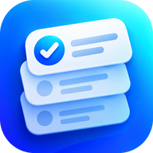
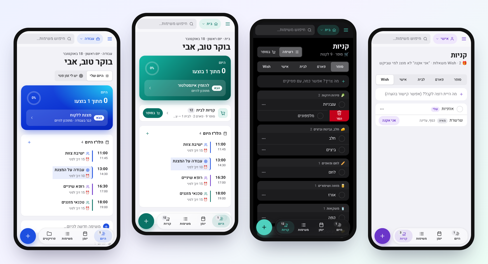
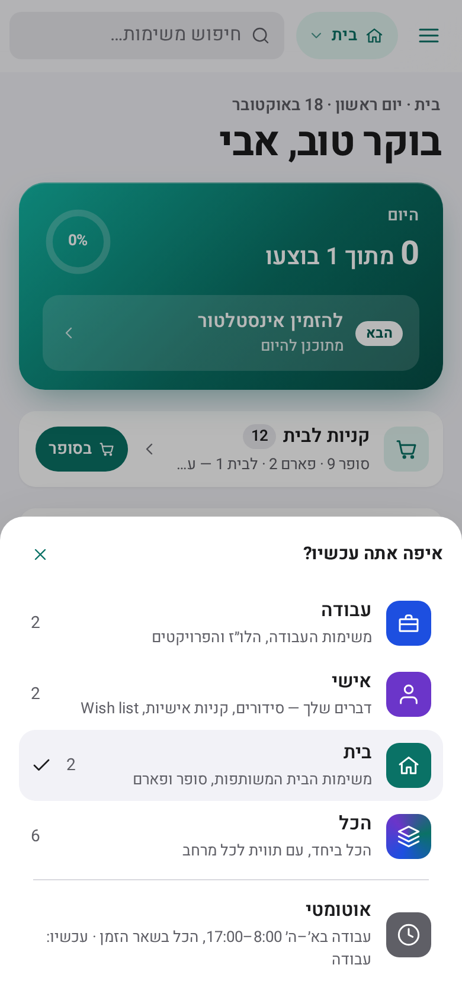
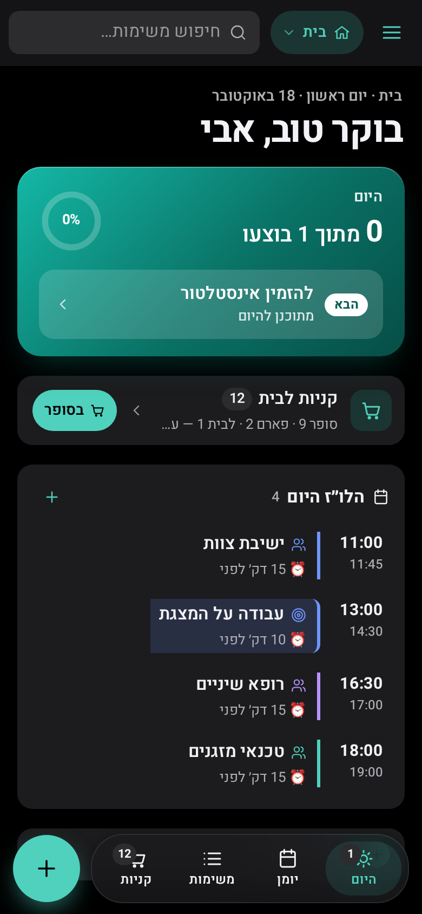
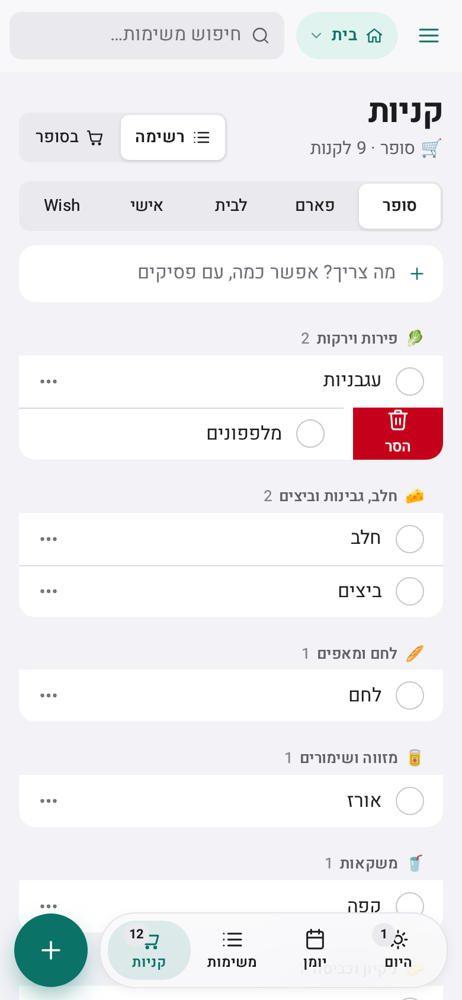
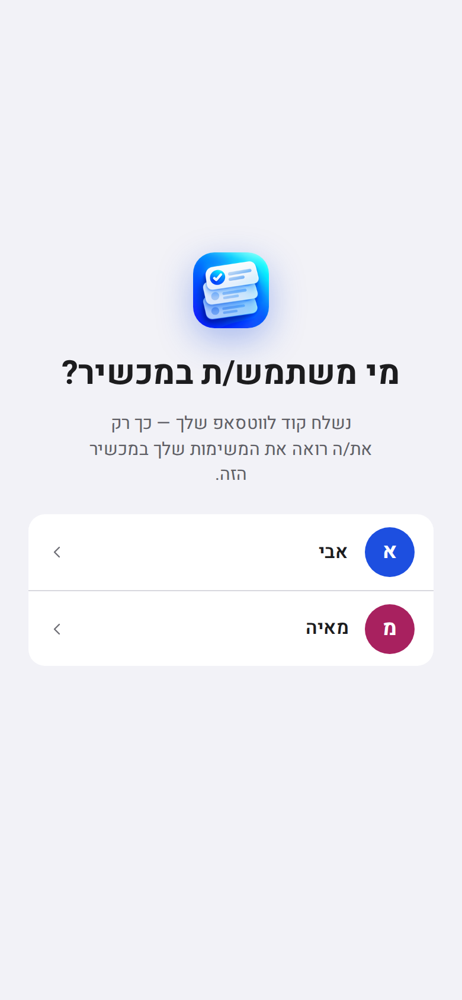

<div align="center">



# Personal Workboard

**A self-hosted task board for one person or a household — that your AI agent runs for you.**

Work, personal and home in one place · a schedule that taps you on WhatsApp before every meeting ·
shared shopping lists that know the supermarket aisles · Hebrew-first, RTL, built like an iPhone app.

[](https://github.com/TalEps77/Personal-Workboard/actions/workflows/ci.yml)


[](LICENSE)



</div>

---

## Why

Most task apps assume you'll sit down and type. Workboard assumes you won't. You tell your agent on WhatsApp
*"קבעתי עם הספק לשלישי ב־10"* or *"תוסיף לקניות חלב וביצים"*, and it files the task, books the slot, reminds
you ten minutes before, and keeps the board honest. When you do open the app, it's a calm, fast PWA that feels at
home on an iPhone and shows the one thing that matters next.

## Features

<table>
<tr>
<td width="50%" valign="top">

**🗂 Contexts, not folders**<br>
Work, personal and a shared home space. One tap switches the whole app — colour, tabs, what *Today* shows — or
let it follow your work hours automatically.

**👥 Built for two (or more)**<br>
Each person has private spaces and their own agent; the household shares a home space. Shared tasks have an
owner (*עליי · עליה · שנינו*), and nobody can see the other's private tasks — enforced on the server.

**🗓 A schedule that reminds you**<br>
Meetings and blocked work time, coloured by the part of life they belong to. A WhatsApp heads-up before each one
(15 min before meetings, 10 before work blocks), with the linked task's next step.

</td>
<td width="50%" valign="top">

**🛒 Shopping that knows the store**<br>
Supermarket, pharmacy, house, personal and wish lists. Items sort themselves into aisles (and learn your fixes),
a big-target *in the store* mode keeps the screen on, and on a wish list you can quietly mark *"I'll buy this"* —
the one who wished never sees it.

**🤖 Agent-native (MCP)**<br>
13 typed tools over MCP. Hebrew dates are resolved on the server (*"חמישי שאחרי"*, *"מחר ב־7:30 בערב"*),
batch writes report per item, every change is undoable.

**📱 Feels native**<br>
Installable PWA, offline read-only snapshot, live updates, swipe actions with spring physics, light & dark,
Dynamic Type, full RTL, and copy that addresses each person in their own grammatical gender.

</td>
</tr>
</table>

## Quick start

```bash
git clone https://github.com/TalEps77/Personal-Workboard.git
cd Personal-Workboard

# Your instance lives outside the repository: config, secrets and data.
mkdir -p ~/workboard-instance/data
sudo chown -R 1000:1000 ~/workboard-instance/data      # the container runs as uid 1000
cp examples/.env.example ~/workboard-instance/.env     # edit: hosts, time zone, tokens, and set
                                                        # WORKBOARD_DATA_DIR / WORKBOARD_ENV_FILE to ABSOLUTE paths
cp examples/people.json ~/workboard-instance/data/      # optional — for more than one person

docker compose --env-file ~/workboard-instance/.env up -d
```

Open it through an HTTPS reverse proxy (Caddy, Tailscale serve, nginx — see [deploy](docs/deploy.md)), pair your
phone with the code that arrives on WhatsApp (no agent connected yet? the code is in `docker logs workboard`), and
*Add to Home Screen*.

Just want to look around? `npm run dev` starts a local board with sign-in disabled at `http://127.0.0.1:4173`.

## How it fits together

```text
   you ──WhatsApp──▶  your agent (e.g. Hermes)  ──MCP tools──▶  Workboard  ◀──PWA──  your phone
                            ▲                                       │
                            └── signed webhook: reminders, digest, pairing codes ──┘
```

- **Workboard** — one Node 22 process, no dependencies, files as the database (each task is a readable Markdown
  file), a single lock and atomic writes, per-person scoping of everything it serves.
- **Your agent** — talks to you and calls the tools. Workboard does the date math, the reminders and the delivery.
- **Your phone** — the dashboard: *Today*, the schedule, all tasks, projects, shopping.

<div align="center">
&nbsp;
&nbsp;
&nbsp;

</div>

## Documentation

| | |
| --- | --- |
| [Connecting an agent (Hermes)](docs/hermes.md) | MCP setup, delivery webhook, one agent per person, the agent skill |
| [MCP tools reference](docs/tools.md) | Every tool and parameter (generated from the code) |
| [Configuration](docs/configuration.md) | Environment variables, `people.json`, board structure |
| [Multiple people](docs/multi-user.md) | People, spaces, visibility, shared tasks, reminder routing |
| [Self-hosting & updates](docs/deploy.md) | Reverse proxy, backups, the safe auto-update pipeline |
| [Architecture](docs/architecture.md) | Modules, data model, live updates, concurrency |
| [Security](docs/security.md) | Threat model and controls · [report a vulnerability](SECURITY.md) |
| [Design system](docs/design-system.html) | Tokens, components and rules — readable by people and by models |

## Safe updates from a public repo

Self-hosted instances can follow `main` without trusting every push: [`deploy/update.sh`](deploy/update.sh)
deploys a commit only if it is a **fast-forward**, its **GitHub checks are green**, the **unit tests pass again
locally** in a network-less container, and the new container comes up **healthy** — otherwise it rolls back.
Open apps pick up the new build by themselves. Details in [docs/deploy.md](docs/deploy.md).

## Development

```bash
npm run dev            # local board, sign-in disabled, loopback only
npm test               # unit + API tests (node --test)
npm run test:browser   # Playwright suites: single-user, two people, iOS zoom checks (PW_DIR=/path/to/playwright)
npm run docs:tools     # regenerate docs/tools.md after changing an MCP tool
```

No `npm install` needed — the app has zero runtime dependencies. See [CONTRIBUTING.md](CONTRIBUTING.md).

## Language

The interface, the agent replies and the date vocabulary are **Hebrew** (English date words work too), and the
whole UI is RTL-first. The code, the docs and the API are in English. Translations are welcome.

## License

[MIT](LICENSE)
